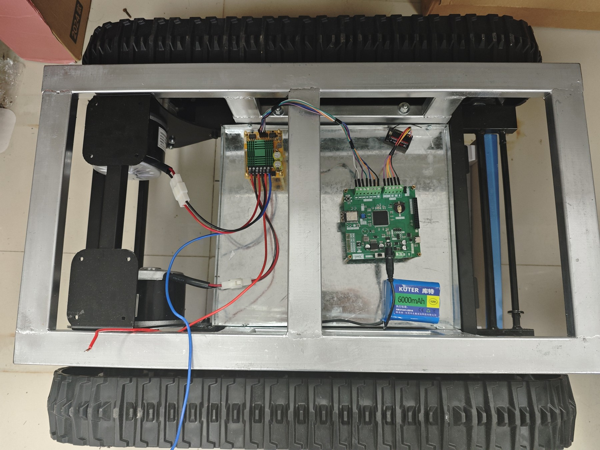
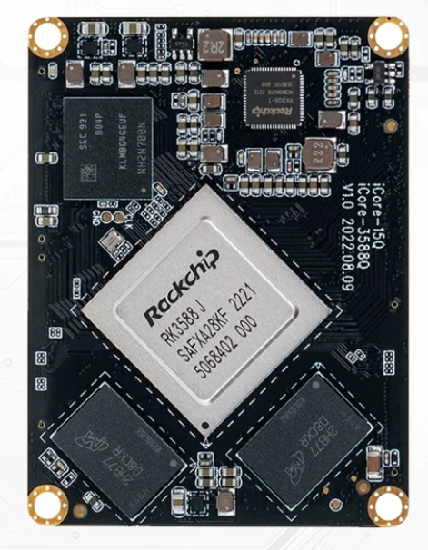
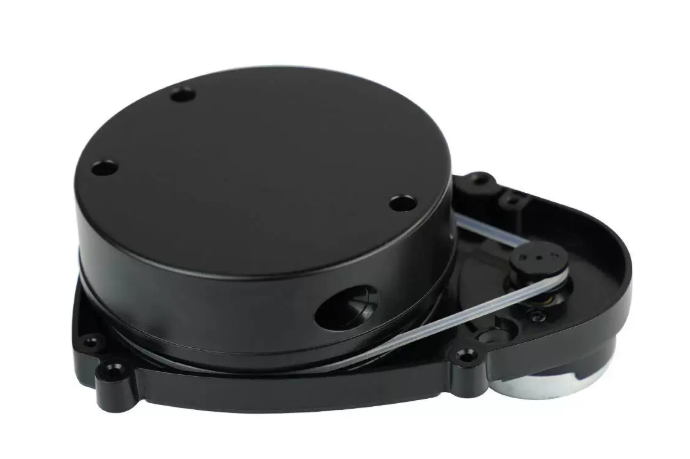
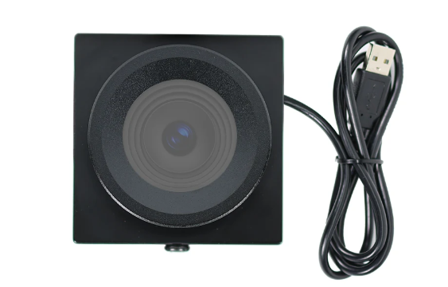

# 基于物联网的移动式割胶机器人

**STM32F407 主控 · 履带底盘 · 无线遥控 · Wi-Fi / MQTT · Web 上位机 · RK3588 计算平台**

面向橡胶园作业的移动式机器人项目，以自制 STM32F407 控制板组织履带底盘、电机驱动、遥控输入和联网监视。设备端负责脉宽采集、安全状态机与双电机输出；ESP-12F 将状态送入 MQTT，Python 服务与 Web 页面提供设备状态、通信记录和调试入口。

[实物与硬件](#实物与硬件) · [工程入口](#工程入口) · [源码目录](#源码目录) · [构建说明](docs/BUILD.md) · [验证记录](docs/VALIDATION.md)

## 实物与硬件

### 履带底盘与控制系统



履带底盘内部安装 STM32F407 控制板、电机驱动和遥控接收器。控制板采集遥控 PWM 信号，经过解锁、回中和失效保护判断后输出双电机驱动信号，将遥控输入、安全逻辑与底盘动作连成完整链路。

### 计算与感知器件

| RK3588 核心板 | 激光雷达模块 | USB 摄像头 |
| :---: | :---: | :---: |
|  |  |  |
| 上层计算平台，配套 Ubuntu 24.04 / ROS 2 Jazzy 软件环境 | 环境距离感知器件 | 图像采集器件 |

上述四张图片展示本项目的底盘控制系统与计算、感知硬件。STM32 承担实时执行与本地保护，RK3588 对应上层软件平台；各硬件角色与软件工程入口按职责分别组织。

## 核心设计

| 环节 | 工程实现 | 阅读入口 |
| --- | --- | --- |
| 遥控输入 | CH1 / CH2 / CH5 PWM 采集与遥控状态处理 | `firmware/chassis_f407` |
| 本地保护 | 锁定、回中解锁、遥控失效停车和启动保护 | 底盘安全状态机与主机测试 |
| 电机控制 | 双电机输出、差速混控、斜坡和换向时序 | 30% / 60% / 100% 电机目标 |
| 联网遥测 | ESP-12F、MQTT 状态发布与 SESSION 握手 | `firmware/board_web_link_test_f407` |
| 网页上位机 | Python MQTT 服务、在线状态、日志和 LED 自检 | `upper_computer/web_link_host` |
| 上层计算 | RK3588、Ubuntu 24.04、ROS 2 Jazzy | [环境与工程记录](docs/progress.md) |

设备动作由 STM32 的本地控制链路执行，网页服务围绕遥测、连接状态和调试信息组织交互。

## 工程入口

| 目录 / Keil 目标 | 主要功能 | 使用场景 |
| --- | --- | --- |
| `firmware/chassis_f407` | 基础履带遥控、安全状态机、LCD/遥控台架 | 基础底盘工程；MQTT 工程复用其核心模块 |
| `board_web_link_test_f407` / `mqttweb1` | 带屏通信、SESSION 握手、LED 自检 | 电机控制脚保持停止 |
| `board_rc_web_test_f407` / `mqttrc1` | 无屏遥控输入、网页遥测 | 左右输出为软件模拟指令 |
| `board_chassis_web_f407_30pct` / `mqttmotor30` | 实际电机输出目标 | PWM 上限 30% |
| `board_chassis_web_f407_60pct` / `mqttmotor60` | 实际电机输出目标 | PWM 上限 60% |
| `board_chassis_web_f407` / `mqttmotor100` | 实际电机输出目标 | PWM 上限 100% |
| `board_led_test_f407`、`board_uart4_test_f407` | 独立焊接、串口检查 | 分阶段排查入口 |
| `board_wifi_test_f407`、`board_wifi_lcd_test_f407` | 早期 Wi-Fi / LCD 联调 | 保留源码作参考，日常入口采用当前 MQTT 工程 |

五个 MQTT Keil 目标均在 `firmware/board_web_link_test_f407/MDK-ARM`。百分比表示电机 PWM 输出上限，用于分级调试。

## 源码目录

| 目录 | 内容 |
| --- | --- |
| `firmware/` | C 源码、Keil 项目、CMSIS / HAL 与主机测试 |
| `upper_computer/web_link_host/` | Python MQTT 到 HTTP/API 服务、Windows 启停脚本及测试 |
| `upper_computer/web_prototype/` | 网页服务使用的 HTML / CSS / JavaScript 页面 |
| `mechanical/lift_concept/` | Fusion 四柱升降概念生成脚本 |
| `docs/` | 实物照片、构建入口、依赖与验证记录 |

## 网页服务

安装 Python 3.10+，并将 Mosquitto 加入 PATH。Python 依赖：

```powershell
python -m pip install -r requirements-dev.txt
.\upper_computer\web_link_host\start.ps1 -NoBrowser
```

浏览器打开 `http://127.0.0.1:18080/`。设备 MQTT 默认端口为 1883。停止本项目服务：

```powershell
.\upper_computer\web_link_host\stop.ps1
```

首次运行前，在相应固件的 `Inc/test_config.h` 填写 `WIFI_SSID`、`WIFI_PASSWORD`。MQTT 目标默认从热点网关取得 broker 地址，使用其他网络时配置电脑实际地址。网页根据 SESSION 回传、broker 状态及 5 秒内有效心跳判断设备在线，便于区分网络接入和业务通信状态。

## 构建与验证

Keil 项目使用 STM32F407ZG、ARM Compiler 5 设置。无屏 RC/电机目标可直接从源码重建；LCD 目标的厂商初始化表和本地字体生成步骤见 [构建说明](docs/BUILD.md)。编译不自动烧录。

```powershell
python -B -m pytest -p no:cacheprovider -q upper_computer/web_link_host/tests/test_host.py upper_computer/web_link_host/tests/test_mqtt_session.py upper_computer/web_link_host/tests/test_rc_telemetry.py
python -B upper_computer/web_link_host/tests/test_mqtt_integration.py
```

测试命令、环境与结果见 [发布验证](docs/VALIDATION.md)。底盘调试先将履带架空，依次核对电机方向、PWM 输出、接收机失控保护与独立断电。

## 来源与依赖

实物与硬件图片由项目作者提供。ST、Arm 及其他第三方组件沿用原版权和许可，详见 [第三方与生成依赖](THIRD_PARTY_NOTICES.md)。
